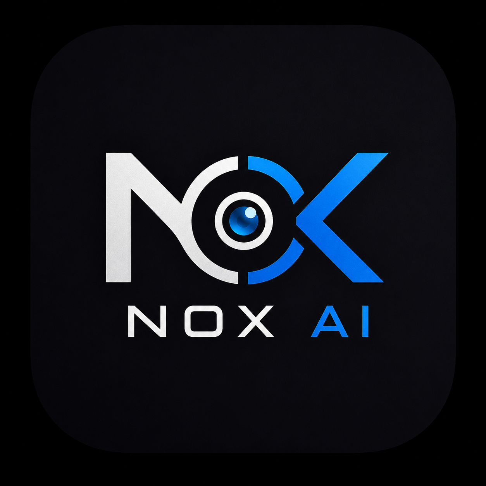
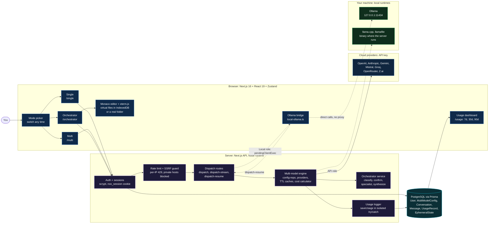
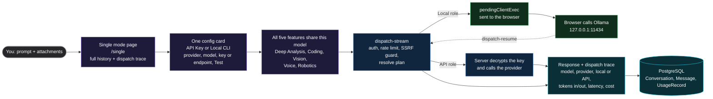
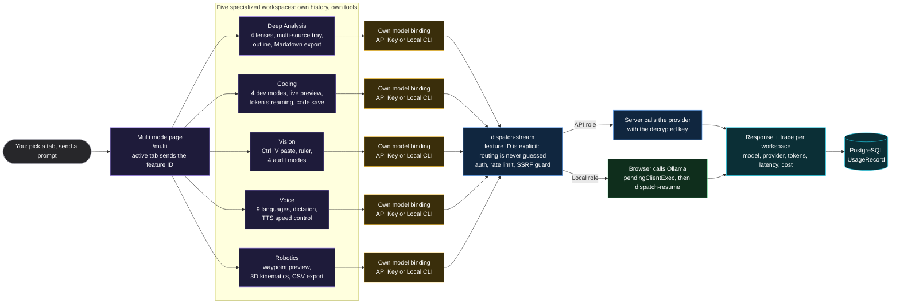
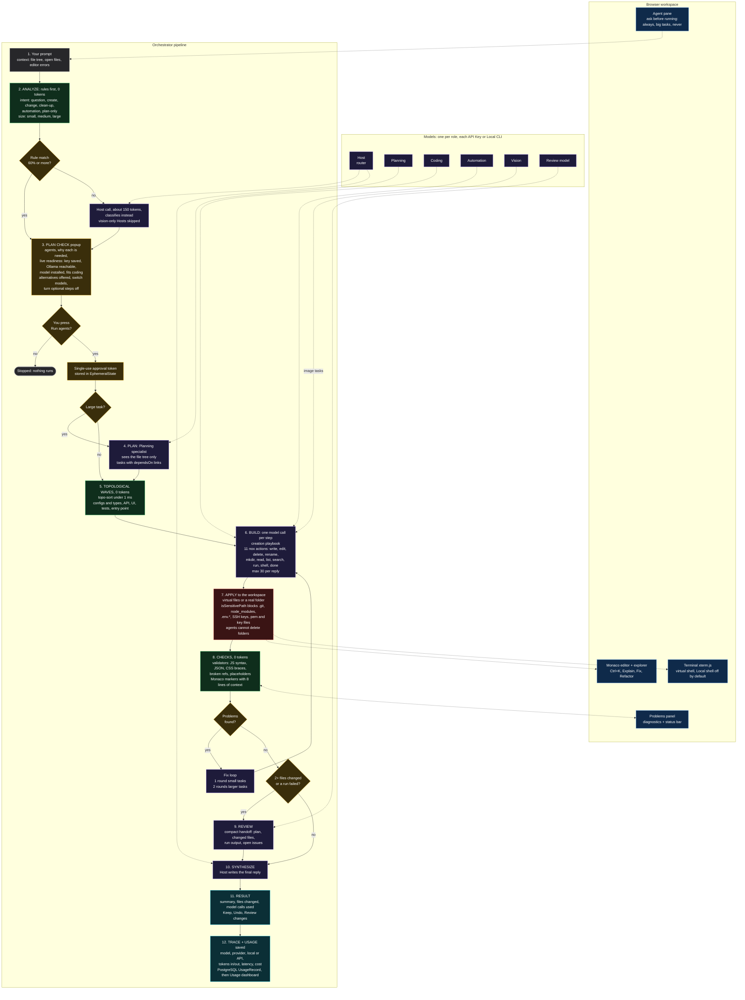

<p align="center">
  
</p>

<h1 align="center">NOX-AI</h1>

<p align="center"><b>Local-first multi-model AI workstation with an integrated Monaco IDE, terminal and cost telemetry.</b></p>

<p align="center">
Bring your own API keys or run local Ollama models. Pick which model handles which task, watch agents edit real files in an editor, and see the model, tokens, latency and cost of every call.
</p>

<p align="center">
  <a href="https://nox-ai-ten.vercel.app"></a>
  <a href="https://github.com/sseraladen-svg/NOX-AI/actions/workflows/ci.yml"></a>
  
  
  
  
  
  
  
</p>

<p align="center">
  <a href="https://nox-ai-ten.vercel.app"><b>Live app</b></a> ·
  <a href="public/videos/nox-demo.mp4"><b>Demo video</b></a> ·
  <a href="#why-nox-ai">Why NOX-AI</a> ·
  <a href="#quick-start">Quick start</a> ·
  <a href="#how-it-works">How it works</a> ·
  <a href="#orchestrator-workspace">Orchestrator workspace</a> ·
  <a href="#metrics">Metrics</a> ·
  <a href="#design-notes">Design notes</a> ·
  <a href="CONTRIBUTING.md">Contributing</a> ·
  <a href="SECURITY.md">Security</a>
</p>

## System overview



<sub>Diagram renders natively on GitHub. Click it to zoom and pan.</sub>

> **Open for contribution.** Anyone can fork this repository, create a branch (`feat/…`, `fix/…`, `docs/…`) and open a pull request. See [CONTRIBUTING.md](CONTRIBUTING.md).
>
> **Built solo.** The research, planning, architecture, building, bug fixing and documentation of NOX-AI were all done by one person: Sera ([@sseraladen-svg](https://github.com/sseraladen-svg)).

<table align="center">
  <tr>
    <td align="center"><br><sub><b>Mode picker</b></sub></td>
    <td align="center"><br><sub><b>Usage and cost</b></sub></td>
    <td align="center"><br><sub><b>Orchestrator IDE</b></sub></td>
  </tr>
  <tr>
    <td align="center"><br><sub><b>Orchestrator config: Host</b></sub></td>
    <td align="center"><br><sub><b>Orchestrator config: specialists</b></sub></td>
    <td></td>
  </tr>
</table>

---

## Why NOX-AI

People now use several AI models: one for chat, one for code, one for images. Each has its own app, keys, limits and billing. In practice that means constant switching, no single view of what each call cost, and local models that take manual setup most people never finish.

NOX-AI is one workspace where you connect your own providers and decide how they are used. It does three things:

| | |
|---|---|
| **Assign** | Choose the provider, model, key and connection type (API or local) per feature, for the Host and for each specialist. |
| **Orchestrate** | A Host model classifies the request and shows you the plan. After you confirm, a specialist runs it and the Host writes the final answer. |
| **Track** | Every response carries a dispatch trace: model, provider, local or API, tokens in and out, latency and cost. |

The result is the right model for each task, a routing decision you can see and stop, and a usage dashboard built from provider-reported token counts.

## Quick start

Needs Node.js 20 or later (22 or later to run `npm test`) and a PostgreSQL database. Ollama is optional.

```powershell
git clone https://github.com/sseraladen-svg/NOX-AI.git
cd NOX-AI
npm ci
Copy-Item .env.example .env
# edit .env, see Configuration below
npx prisma db push
npm run dev
```

Open http://localhost:3000, or use the hosted app at https://nox-ai-ten.vercel.app.

`npx prisma db push` syncs the schema without migrations. Use it on a development database only.

### Use local Ollama with the hosted app

Your browser talks to Ollama on your own machine. There is no proxy and no tunnel, so the site must be allowed to call it.

```powershell
ollama pull llama3.2:latest
[Environment]::SetEnvironmentVariable("OLLAMA_ORIGINS", "https://nox-ai-ten.vercel.app,http://localhost:3000", "User")
```

Quit Ollama completely (also from the system tray) and start it again. In NOX-AI choose **Local CLI**, provider **Ollama**, endpoint `http://127.0.0.1:11434`, pick the model and press **Test**.

macOS and Linux:

```bash
OLLAMA_ORIGINS="https://nox-ai-ten.vercel.app,http://localhost:3000" ollama serve
```

| Problem | Fix |
|---|---|
| Port already in use | Ollama starts at login. Run `Stop-Process -Name "ollama*" -Force`, then start it again. |
| HTTP 400 when sending an image | The model is text-only. Use a vision model such as `llama3.2-vision` or `moondream`. |
| Out of memory on load | The model is too large for your RAM or GPU. Try a smaller one. |

## How it works

The full system diagram is at the top of this page. Each mode has its own diagram below, and all of them are plain text in this file, so you can edit them in a pull request.

**Request flow**

1. The browser sends the message to `dispatch-stream`.
2. The server checks auth and rate limits, loads the role's config and decrypts its API key.
3. The server builds the plan. Single and Multi use the role's config directly. Orchestrator classifies the request, asks for your confirmation, runs the specialist, then synthesizes.
4. **API role:** the server calls the provider.
5. **Local Ollama role:** the server returns a `pendingClientExec` signal. Your browser runs the prompt on your own Ollama and posts the result to `dispatch-resume`, and the server continues the pipeline.
6. The trace and usage record are saved and returned.

### Single mode (`/single`)



One configured model, local Ollama or cloud API, handles every request with full conversation history and a dispatch trace.

### Multi mode (`/multi`)



Five workspaces. Each keeps its own conversation history, model binding and dedicated tools. The active tab sends the feature ID, so routing is explicit and nothing is guessed.

| Workspace | What it adds |
|---|---|
| **Deep Analysis** | 4 analysis lenses (Deep Breakdown, Trade-off Matrix, Risk & Failure Audit, Executive Brief), a multi-source context tray (`.txt`, `.md`, `.csv`, `.json`, `.log`) with live token estimates, section outline, Markdown export. |
| **Coding** | Live token-by-token code streaming into a syntax-highlighted editor, 4 dev modes (Generate, Debug Error, Refactor, Write Tests), target language selector, live HTML preview, copy, explain, file download. |
| **Vision** | `Ctrl+V` screenshot paste, drag-and-drop upload, pixel-distance ruler, 4 audit modes (UI to React/Tailwind, OCR to JSON, Defect and Layout Audit, Diagram to Spec). |
| **Voice** | Browser speech-to-text in 9 languages (`en-US`, `en-GB`, `en-IN`, `hi-IN`, `ta-IN`, `es-ES`, `fr-FR`, `de-DE`, `ja-JP`), continuous dictation, live waveform meter, text-to-speech with speed control. |
| **Robotics** | X/Y waypoint SVG preview, live 3D kinematics metrics (total distance, estimated cycle time from Speed and Acceleration sliders), one-click CSV export. |

### Orchestrator mode (`/orchestrator`)



A Host model classifies the request and shows the plan. After you confirm, a specialist (Planning, Coding, Vision or Automation) runs it and the Host writes the final answer.

- **Intent-aware routing** (`agent-routing.ts`). Intent is decoupled from prompt length, so project-creation prompts always run Plan, Build, Review.
- **Topological task waves** (`topo-sort.ts`). `dependsOn` task graphs are sorted in under 1 ms with 0 tokens, so configs and types are written before APIs and UI.
- **Closed-loop editor and terminal** (`editor-bridge.ts`, `agent-exec.ts`). Agents get 1-based line numbers, the cursor line and active editor errors, listen to `onDidChangeMarkers`, receive ±8 lines of context around errors, and tolerate stray `42 |` prefixes or indentation shifts in `<nox:edit>`.

## Orchestrator workspace

Orchestrator mode opens as a code workspace. A header toggle returns to the classic chat layout.

| Area | What you get |
|---|---|
| **Editor** | Monaco (the VS Code engine): IntelliSense and diagnostics for JS/TS/JSON/CSS/HTML, multi-cursor, folding, minimap, find/replace, format on save, 8 themes. |
| **Files** | A virtual workspace in your browser (IndexedDB), uploads, or **Open folder** to edit a real folder through the File System Access API (Chrome and Edge). `node_modules`, `.git`, `.next`, `dist` and binary or very large files are skipped. |
| **Navigation** | Quick Open `Ctrl+P`, command palette `Ctrl+Shift+P`, go to line `Ctrl+G`, go to symbol `Ctrl+Shift+O`, breadcrumbs, draggable tabs. |
| **Search** | Find in Files `Ctrl+Shift+F` with regex, case, whole word, include/exclude globs, replace in file or everywhere. |
| **Changes** | Everything changed since the workspace opened, side-by-side diffs, discard per file, accept all. |
| **Problems** | Problems panel and status bar counts from editor diagnostics. |
| **Terminal** (xterm.js) | Virtual shell (`ls`, `cd`, `cat`, `mkdir`, `touch`, `rm`, `mv`, `cp`, `grep`, `find`, `tree`, `open`, `node file.js`). JavaScript runs in a sandboxed iframe worker with an 8 second limit. HTML previews in a sandboxed iframe. |
| **Local shell** | Real commands on the machine hosting the app. Off by default. Needs `NOX_LOCAL_TERMINAL=1`, a signed-in user, a `localhost` request, and a non-Vercel host. Secrets are removed from the command environment. |
| **Cursor-style AI** | `Ctrl+K` edits the selection with your Coding model. Optional ghost-text completions, off by default because they use tokens. |

### Agent: AI that edits your files

The **Agent** tab works like VS Code agent mode. You describe a task. The agents create, edit, read, rename and delete files themselves, run JavaScript to check their work, and show every step.

1. **Analyze (rules first, 0 tokens).** Rules classify intent (question, create, change, clean-up, automation, plan-only), size and the agents needed. If the match is under 60%, one tiny Host call (about 150 tokens) classifies it instead.
2. **Plan check popup.** You see which agents will run, why, and whether each model is ready: key saved, Ollama reachable, model installed, model suited to coding. You can switch models, turn optional steps off, then press **Run agents**.
3. **Run.** Plan (large tasks), Build with a creation playbook, automatic checks, then Review only when useful. Each step is one model call.
4. **Result.** Summary, files changed, model calls used, and **Keep / Undo / Review changes**.

| Task | Agents | Steps |
|---|---|---|
| Question | Coding, read-only | up to 3 |
| Small create or change | Coding | up to 4 |
| Medium | Coding, optional Review | up to 8 |
| Large | Planning, Coding, Review | up to 12 |
| "Plan …" | Planning only | 1 |

**Quality checks** (`validators.ts`, 0 tokens) run on every changed file: JavaScript syntax, JSON validity, CSS braces, broken `src`/`href`/`import` references, leftover placeholders, plus editor diagnostics. Problems go straight back to the builder to fix, then are re-checked.

**Agent protocol.** 11 actions, max 30 per reply: `<nox:write>`, `<nox:edit>`, `<nox:delete>`, `<nox:rename>`, `<nox:mkdir>`, `<nox:read>`, `<nox:list>`, `<nox:search>`, `<nox:run>`, `<nox:shell>`, `<nox:done>`.

**Safety.** `.env`, keys, `.git` and `node_modules` are never read, sent to a model or modified. Agents cannot delete folders. Shell commands need the Local shell plus a confirmation for each command.

For reliable editing use a coder model of 7B or more, for example `qwen2.5-coder:7b`. Very small models often break the action format.

## Providers

| Type | Providers |
|---|---|
| **API** | OpenAI, Anthropic, Gemini, Mistral, Groq, OpenRouter, Z.ai |
| **Local** | Ollama, llama.cpp, llamafile |

Local or API is chosen separately for each feature, the Host and each specialist.

## Metrics

| Dimension | Value | Notes |
|---|---|---|
| Execution modes | **3** | Single, Multi, Orchestrator |
| Multi mode workspaces | **5** | Deep Analysis, Coding, Vision, Voice, Robotics |
| Orchestrator specialists | **4 + Host** | Planning, Coding, Vision, Automation |
| Provider entries | **10** | 7 API, 3 local |
| Backend service modules | **7** | `cache`, `shared`, `config-repo`, `providers`, `orchestrator`, `conversations`, `usage-logger` |
| TTL cache layers | **2** | 60 s model reachability, 30 s user config (invalidated on save) |
| Agent protocol actions | **11** | Max 30 per reply |
| Voice languages | **9** | Browser speech-to-text |
| Automated test suites | **5** | `agent`, `endpoint-guard`, `guest-session`, `workspace`, `routing-and-topo` |
| Documented API routes | **28** | Across 9 groups, see API overview |
| Key encryption | AES-256-GCM | 32-byte SHA-256 derived key |
| Codebase | **94.3% TS, 4.8% JS, 0.9% CSS** | TypeScript 5, `strict: true` |

## Configuration

| Variable | Required | Purpose |
|---|---|---|
| `DATABASE_URL` | Yes | PostgreSQL connection string |
| `POSTGRES_URL` | Yes (Vercel) | Same database, used by the Vercel integration |
| `NOX_AI_SECRET` | Yes | Encrypts stored API keys |
| `AUTH_SECRET` | Yes | Signs session tokens |
| `ELEVENLABS_API_KEY` | No | Enables text-to-speech |
| `ELEVENLABS_VOICE_ID` | No | Voice used for text-to-speech |
| `NOX_LOCAL_TERMINAL` | No | `1` enables the Local shell tab (local machine only) |
| `NOX_WORKSPACE_ROOT` | No | Root folder for the Local shell |

Use long random strings for both secrets and keep them out of version control.

### Deploy to Vercel

Set the variables above in the project settings. The build command is `npm run vercel-build` (`prisma generate && next build`). Pick a database region and a deployment region your AI providers support.

### Scripts

| Command | Purpose |
|---|---|
| `npm run dev` | Dev server on port 3000 (`--webpack`) |
| `npm run build` | Production build (`standalone` output) |
| `npm run typecheck` | `tsc --noEmit` |
| `npm run lint` | ESLint flat config |
| `npm test` | All 5 suites via `node --test tests/*.test.mjs` (Node 22+) |
| `npm run db:push` | Sync `prisma/schema.prisma` to PostgreSQL |

CI runs typecheck, lint, test and build on every pull request.

## Accounts and guest mode

- **Account.** Configs, conversations and usage are stored per user. API keys are encrypted.
- **Guest.** Settings and history stay in your browser storage. No usage metrics are recorded, Orchestrator is unavailable, and hosted models need an API key entered for each request. Guest requests are limited to 10 MB.

## API overview

| Group | Routes |
|---|---|
| Auth | `/api/auth/signup`, `login`, `logout`, `me`, `reset-password` |
| Config | `/api/multi-model/config`, `providers`, `test`, `limits`, `export-import` |
| Dispatch | `/api/multi-model/dispatch`, `dispatch-stream`, `dispatch-resume` |
| Conversations | `/api/conversations/list`, `create`, `get`, `rename`, `delete`, `save-message` |
| Usage | `/api/usage/summary`, `/api/usage/recent` |
| Workspace | `/api/workspace/exec`, `/api/workspace/agent-turn` |
| Health | `/api/health` |
| Guest | `/api/guest/dispatch`, `dispatch-resume`, `test` |
| Voice | `/api/voice/elevenlabs` |

## Security

- API keys: AES-256-GCM at rest, masked whenever sent back to the browser.
- Passwords: `scryptSync` with per-user salts. Sessions: 30-day `nox_session` cookie.
- All configs, conversations and usage are scoped to the signed-in user.
- Per-IP rate limiting on auth, dispatch and test routes, shared across serverless instances through Postgres.
- SSRF guard: custom endpoints must be http(s), carry no credentials, avoid cloud-metadata hosts, and avoid private or loopback hosts for API connections in production.
- Workspace path guardrails block `.git`, `node_modules`, `.env.*`, SSH keys and `*.pem`/`*.key`.
- Security headers on every response. Error messages and traces never include API keys.

Full policy and reporting steps: [SECURITY.md](SECURITY.md).

## Design notes

| Decision | Why | Trade-off |
|---|---|---|
| Bring your own key | No markup, no compute bill for the platform | Users need their own keys |
| Browser-side Ollama bridge | A hosted server cannot reach a user's `localhost`, and tunnels add an install step | Needs one Ollama setting. llama.cpp and llamafile cannot use it |
| Explicit feature ID in Multi | Deterministic routing | The user picks the tab |
| Model-driven classification plus a confirmation step | The routing decision is visible and can be stopped | Extra model calls per request |
| Provider-reported tokens for cost | Real numbers, not estimates | The pricing table must be kept up to date |
| Approvals, resume steps and rate limits in Postgres | In-memory state breaks across serverless instances | One small table and a query per check |
| No automatic retry | Retries were doubling requests into rate limits | A one-off network blip shows as an error |
| Separate timeouts for checks and generations | Long answers need more time than a reachability ping | Two values to tune |
| Rules before models in the agent | Intent and agent choice cost 0 tokens | Rules can miss unusual phrasing, so a tiny Host call backs them up |

### Known limitations

- **Streaming** is real for Gemini and for Ollama in the browser. Other providers return the full response at once.
- **Attachments are not RAG.** Text is added to the prompt (capped at 100,000 characters). There is no chunking, embedding or retrieval.
- **llama.cpp and llamafile** need the binary on the machine running the server, so they do not work on a hosted deployment.
- **Engineering specialist** works on the project folder of the machine running the server. It is meant for local use.
- **Image generation** supports OpenAI only.
- **No quota fallback.** If a provider runs out of quota the call fails.
- **No admin or team view.** Each user sees only their own usage.
- **Workspace** was verified with unit tests, a production build and API tests for the Local shell, but not driven in a real browser during development. Real-folder access works only in Chromium browsers. Terminal line editing supports typing, backspace and history, not cursor movement. Monaco loads from a CDN, so the editor needs internet access.
- **Not included:** a debugger, an extensions marketplace, language servers beyond JS/TS/JSON/CSS/HTML, real git, split editor groups.

## Project layout

```text
src/
  app/                  pages (/, /single, /multi, /orchestrator, /usage) and API routes
  components/nox/       mode pages, feature UIs, mode picker, usage dashboard
  components/nox/workspace/   editor, explorer, terminal, preview, IDE layout
  hooks/                use-chat.ts (SSE handling, confirmation and resume flow)
  store/                Zustand stores (config, conversations)
  lib/
    multi-model/        cache, shared, config-repo, providers, orchestrator, conversations, usage-logger
    workspace/          vfs, <nox:...> protocol, topo-sort, agent-runner, editor-bridge, validators
    auth.ts  crypto.ts  db.ts  rate-limit.ts  ephemeral-state.ts  endpoint-guard.ts
    local-ollama.ts  guest-session.ts  engineering-workspace.ts
prisma/schema.prisma    User, MultiModelConfig, Conversation, Message, UsageRecord, EphemeralState
tests/                  node:test suites
.github/                CI workflow and pull request template
```

## Roadmap

- Automatic fallback to another configured model when a provider fails or hits quota
- Streaming for the remaining providers
- Retrieval over uploaded documents (chunking and embeddings)
- Image generation on more providers
- Tool calling for agents beyond the Engineering specialist

## Contributing

Issues and pull requests are welcome. Read [CONTRIBUTING.md](CONTRIBUTING.md) and run typecheck, lint and tests first.

## License

MIT

Built by [@sseraladen-svg](https://github.com/sseraladen-svg)
